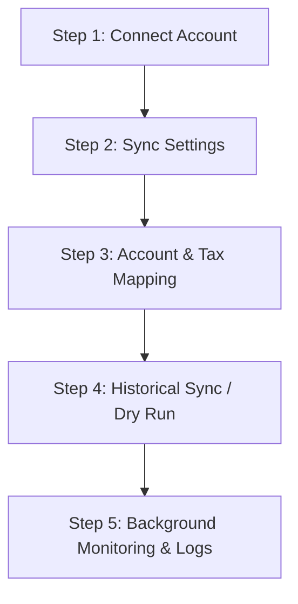

# WPCalibrate Accounting Sync

[](https://www.gnu.org/licenses/gpl-2.0.html)
[](https://wordpress.org)
[](https://woocommerce.com)
[](https://php.net)
[](https://developer.woocommerce.com)

**WPCalibrate Accounting Sync** is an enterprise-grade commercial WordPress plugin connecting WooCommerce with Intuit QuickBooks Online. Built with strict PHP 8.2+ typing, asynchronous background queuing, idempotent ledger persistence, and AES-256-GCM encryption, it automates accounting reconciliation without slowing down customer checkout or altering core files.

---

## Table of Contents
- [About](#about)
- [Features](#features)
- [Documentation & Setup](#documentation--setup)
  - [System Requirements](#system-requirements)
  - [Installation](#installation)
  - [Intuit App Configuration](#intuit-app-configuration)
  - [Configuration Workflow](#configuration-workflow)
  - [Architecture & Mechanics](#architecture--mechanics)
- [WordPress Dashboard Updates](#wordpress-dashboard-updates)
- [Changelog](#changelog)
- [License & Support](#license--support)

---

## About

Managing e-commerce bookkeeping manually leads to accounting discrepancies, delayed financial reporting, and human error. **WPCalibrate Accounting Sync** bridges WooCommerce and QuickBooks Online via official OAuth 2.0 and REST APIs.

Every order, customer, line item, shipping charge, fee, discount, tax breakdown, and payment transaction is transformed into a compliant QuickBooks Online accounting entry. All synchronization happens asynchronously via WooCommerce Action Scheduler, guaranteeing that high-traffic checkout flows remain instantaneous.

### Core Value Principles
- **Zero Core Alterations:** Pure WordPress hooks and WooCommerce CRUD. Core files and database schemas remain uncompromised.
- **100% Traceability:** A dedicated idempotent ledger table tracks every WooCommerce entity against QuickBooks Online IDs with cryptographic hash verification.
- **Enterprise Security:** Secrets and access tokens are encrypted with AES-256-GCM. Sensitive payment details and financial PII are automatically scrubbed from audit logs.
- **Self-Healing Reconciliation:** A background reconciliation engine regularly inspects a 48-hour sliding window to catch and recover any orders interrupted by external network latency.

---

## Features

### 1. Official Intuit OAuth 2.0 Connection
- Connect seamlessly to either **Sandbox** or **Production** QuickBooks environments.
- Single-use, time-limited cryptographic state tokens defend against CSRF attacks during the authorization handshake.
- Automatic token refresh with transient mutex locking to prevent concurrent token race conditions.

### 2. Dual Accounting Modes
- **Sales Receipt Workflow:** Generates a unified Sales Receipt for instant point-of-sale and paid e-commerce transactions, recording payment deposits simultaneously.
- **Invoice + Payment Workflow:** Ideal for B2B stores and invoiced workflows. Generates a formal QuickBooks Invoice upon order creation and a linked Payment transaction upon payment completion.

### 3. Asynchronous Background Queue
- Leverages the WooCommerce Action Scheduler queue for all external API operations.
- Customer checkout latency is decoupled from QuickBooks Online API response times.
- Configurable exponential backoff and retry mechanisms for network failures.

### 4. Idempotent Deduplication Ledger
- Dedicated `wp_wpcalibrate_sync_mapping` table stores bidirectional entity relationships (`order`, `customer`, `product`, `refund`).
- Cryptographic payload hashing prevents duplicate invoices, double-billed sales receipts, or repeated payment creations.

### 5. Two-Way Inventory Synchronization with Loop Prevention
- Synchronize stock levels between WooCommerce and QuickBooks Online.
- Configurable direction: WooCommerce to QuickBooks, QuickBooks to WooCommerce, or Disabled.
- Transient origin tagging prevents infinite echo loops when stock updates oscillate between platforms.

### 6. Comprehensive Financial Entity Mapping
- **Tax Mapping:** Map individual WooCommerce tax rates to specific QuickBooks TaxCodes.
- **Payment Method Mapping:** Route different gateways (Stripe, PayPal, COD, Direct Bank Transfer) to specific QuickBooks Deposit Accounts and PaymentMethods.
- **Shipping & Fee Mapping:** Map shipping methods and handling fees to dedicated income accounts.
- **Fallback Items:** Configurable default income item for legacy or deleted WooCommerce products.

### 7. Historical Sync with Non-Destructive Dry Run
- Synchronize existing orders created before plugin installation.
- Run a safe **Dry Run** estimation to calculate order volumes and inspect matching criteria before queuing batches.
- Batched background processing to prevent server timeouts and memory exhaustion.

### 8. Bank-Grade Security & PII Redaction
- Access and refresh tokens are encrypted at rest using `AES-256-GCM` using site salts.
- Automatic PII redactor scrubs client secrets, OAuth tokens, and credit card numbers from all audit logs.
- Webhook endpoints enforce timing-safe HMAC-SHA256 signature verification (`hash_equals`).

### 9. High-Performance Order Storage (HPOS) & Block Ready
- Declared compatibility with WooCommerce High-Performance Order Storage (HPOS) custom order tables.
- Compatible with WooCommerce Cart & Checkout Blocks.

---

## Documentation & Setup

### System Requirements
| Requirement | Minimum Supported | Tested Up To |
|---|---|---|
| **PHP** | 8.2 | 8.3 |
| **WordPress** | 6.4 | 7.1.2 |
| **WooCommerce** | 8.0 | 11.1.2 |
| **PHP Extensions** | `openssl`, `curl`, `json` | Required |

---

### Installation

#### Method A: WordPress Admin Upload (Recommended)
1. Download the latest `wpcalibrate-accounting-sync-1.0.0.zip` from the [Releases](https://github.com/zeeshanraza-official/wpcalibrate-accounting-sync/releases) page.
2. In your WordPress dashboard, navigate to **Plugins > Add New > Upload Plugin**.
3. Choose the ZIP file and click **Install Now**.
4. Click **Activate Plugin**.

#### Method B: Manual Git / FTP Installation
1. Clone this repository into your plugins directory:
   ```bash
   cd wp-content/plugins/
   git clone https://github.com/zeeshanraza-official/wpcalibrate-accounting-sync.git
   ```
2. In WordPress dashboard, go to **Plugins > Installed Plugins** and activate **WPCalibrate Accounting Sync**.

---

### Intuit App Configuration
1. Log in to the [Intuit Developer Portal](https://developer.intuit.com/).
2. Create an App under **Dashboard > Create an app > QuickBooks Online and Payments**.
3. Under **Production/Development Keys & OAuth**, configure your **Redirect URI**:
   ```
   https://yourdomain.com/wp-admin/admin.php?page=wpcalibrate-accounting-sync&tab=connection
   ```
4. Copy your **Client ID** and **Client Secret**.

---

### Configuration Workflow



1. **Connection (`tab=connection`):**
   - Choose your environment (**Sandbox** for testing, **Production** for live books).
   - Enter your Client ID and Client Secret, then click **Connect to QuickBooks** to complete OAuth authorization.
2. **Sync Settings (`tab=sync`):**
   - Choose your **Accounting Mode** (*Sales Receipt* or *Invoice + Payment*).
   - Choose which order statuses trigger synchronization (e.g., *Processing*, *Completed*).
   - Select your **Inventory Sync Direction**.
3. **Mapping (`tab=mapping`):**
   - Assign QuickBooks TaxCodes for each WooCommerce tax class.
   - Assign deposit accounts and payment methods for each payment gateway.
   - Configure fallback items for shipping, fees, and unmapped historical products.
4. **Historical Sync (`tab=historical`):**
   - Click **Run Dry Run** to calculate the number of eligible past orders.
   - Select your date range and launch the background batch synchronization.
5. **Logs & Diagnostics (`tab=logs`, `tab=diagnostics`):**
   - Inspect sanitized logs with severity filters.
   - Download diagnostic system bundles for troubleshooting.

---

### Architecture & Mechanics

- **Autoloader:** PSR-4 compliant autoloader under namespace `\WPCalibrate\AccountingSync\`.
- **Database Schema:**
  - `wp_wpcalibrate_sync_mapping`: Tracks `wc_id`, `wc_type`, `qbo_id`, `qbo_type`, `sync_status`, `sync_hash`, and timestamps.
  - `wp_wpcalibrate_sync_logs`: Structured audit trail with `level`, `message`, `context`, `payload`, and `created_at`.
- **Concurrency Locks:** Managed via transient mutex locks in `LockManager` with microsecond expiration guards.

---

## WordPress Dashboard Updates

This plugin includes built-in update integration with GitHub Releases:
- Whenever a new release tag and ZIP package are published on this GitHub repository, your WordPress dashboard will automatically notify you under **Dashboard > Updates** and **Plugins > Installed Plugins**.
- You can update directly from the WordPress dashboard with one click, preserving all configuration and mapping data.

---

## Changelog

### [1.0.1] - 2026-10-06
- **Fixed:** Constrained WordPress admin sidebar logo size strictly to standard 20x20px with scoped `admin_head` styling.
- **Fixed:** Resolved "View template not found." error on `Sync Settings` (`tab=sync`) and `Historical Sync` (`tab=historical`) tabs by implementing explicit template file routing.
- **Added:** Comprehensive Purpose, 5-Step How to Use workflow guide, and Architectural Method breakdown inside the Overview tab.
- **Added:** Native GitHub release update checker (`GitHubUpdater`) for single-click updates directly from the WordPress dashboard.
- **Added:** Automated regression test suite Suite 10 covering tab resolution and assets (79/79 passing).

### [1.0.0] - 2026-10-06
- Initial commercial release.
- Complete Intuit OAuth 2.0 integration with automatic token refresh.
- Sales Receipt and Invoice + Payment workflows.
- Asynchronous Action Scheduler integration.
- HPOS (Custom Order Tables) and WooCommerce Blocks compatibility.
- Two-way inventory synchronization with origin-tag loop prevention.
- AES-256-GCM token encryption and PII redactor.
- 48-hour sliding-window reconciliation engine.

---

## License & Support

- **License:** GNU General Public License v2.0 or later ([LICENSE](LICENSE)).
- **Documentation & Marketplace:** [https://marketplace.wpcalibrate.com](https://marketplace.wpcalibrate.com)
- **Author:** [WPCalibrate](https://wpcalibrate.com)
- **Support Email:** [support@wpcalibrate.com](mailto:support@wpcalibrate.com)
